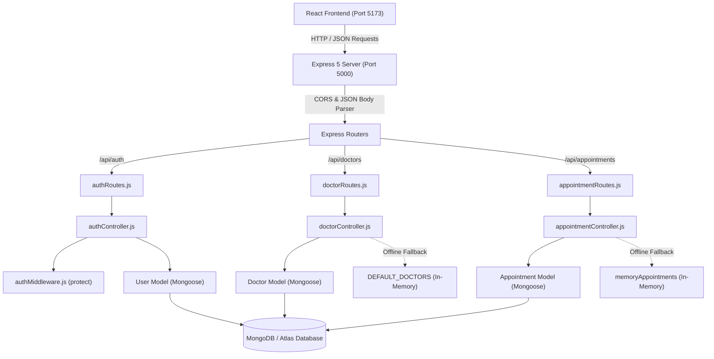

# Appointer Backend Automated Audit Report

**Date of Audit:** November 4, 2026
**Project:** Appointer (Healthcare Appointment Booking Platform)
**Stack:** Node.js (v24), Express (v5.2.1), MongoDB (Mongoose v9.3.0), React (v19)
**Auditor Roles:** Senior Backend Engineer, Security Auditor, QA Engineer, Software Architect
**Scope:** Backend codebase (`backend/`), database layer, API endpoints, authentication, authorization, and frontend compatibility.

---

## 1. Executive Summary

Appointer is a healthcare appointment booking application. A security and architectural audit was performed on the existing backend implementation located in `backend/`. The audit included static code analysis, configuration review, database index and query inspection, and live automated functional and security testing against the running server.

### Overall Verdict: **FAIL / NOT PRODUCTION-READY**
While the backend server successfully initializes, connects to MongoDB, and exposes an initial set of REST endpoints that match the basic prototype UI requirements, it contains **four (4) Critical security vulnerabilities**, several **High-severity authorization and business logic flaws**, and **missing healthcare domain constraints**.

In its current state, an unauthenticated attacker can:
1. Self-register with full `admin` or `doctor` privileges via mass assignment.
2. View all medical appointments for every patient on the platform without logging in.
3. Inject unverified doctor profiles into the public directory without authentication.
4. Modify or delete any patient's appointment records (Insecure Direct Object Reference - IDOR).
5. Double-book identical time slots due to missing concurrency and collision controls.

### Summary of Findings by Severity

| Severity | Count | Primary Impact Areas |
| :--- | :---: | :--- |
| **Critical** | 4 | Privilege Escalation, Confidentiality Breach (Unprotected Appointments), IDOR Deletion, Unauthenticated Doctor Injection |
| **High** | 4 | Hardcoded Fallback JWT Secret, Double-Booking / Race Conditions, Missing RBAC Middleware, No Rate Limiting |
| **Medium** | 6 | NoSQL/ReDoS Injection Risk, Missing Security Headers (`helmet`), In-Memory State Leaks, Missing DB Indexes, Invalid ID 200 Fallback, Sensitive Error Details |
| **Low / Info** | 3 | Missing Token Revocation/Blacklist, Unused Imports, Missing Graceful Process Shutdown |

---

## 2. Project Architecture

### 2.1 Technology Stack

- **Runtime:** Node.js `v24.22.0` (ES Modules)
- **Web Framework:** Express `5.2.1`
- **Database ODM:** Mongoose `9.3.0` (MongoDB 7.x/8.x compatible)
- **Authentication:** JSON Web Tokens (`jsonwebtoken` 9.0.3) & `bcryptjs` 3.0.3
- **Configuration:** `dotenv` 17.3.1
- **CORS:** `cors` 2.8.5
- **Frontend:** React 19, React Router v7, Vite 8

### 2.2 Directory Structure

```text
backend/
├── .env                  # Environment configuration (active)
├── .env.example          # Template environment file
├── package.json          # Node dependencies and npm scripts
├── README.md             # API and setup documentation
└── src/
    ├── config/
    │   └── db.js         # Mongoose connection initialization
    ├── controllers/
    │   ├── appointmentController.js  # Booking & status handlers
    │   ├── authController.js         # Register, login, me handlers
    │   └── doctorController.js       # Directory query & creation
    ├── middleware/
    │   └── authMiddleware.js         # JWT verification middleware
    ├── models/
    │   ├── Appointment.js            # Appointment schema definition
    │   ├── Doctor.js                 # Doctor schema definition
    │   └── User.js                   # User schema definition
    ├── routes/
    │   ├── appointmentRoutes.js      # /api/appointments routes
    │   ├── authRoutes.js             # /api/auth routes
    │   └── doctorRoutes.js           # /api/doctors routes
    ├── seed.js           # Initial database population script
    └── server.js         # Express app entry point
```

### 2.3 Data Flow & Component Architecture



---

## 3. Functionality Audit

### 3.1 Authentication

| Feature | Code Location | Status | Details & Observations |
| :--- | :--- | :---: | :--- |
| **User Registration** | `authController.js:13` | **FAIL** | Hashes passwords with bcrypt (10 rounds) and blocks duplicate emails. However, permits mass assignment of `role: 'admin'`, allowing immediate privilege escalation. |
| **Password Hashing** | `authController.js:26` | **PASS** | Validated: `bcrypt.genSalt(10)` and `bcrypt.hash()` are properly awaited before user creation. |
| **User Login** | `authController.js:51` | **PASS** | Compares password using `bcrypt.compare()`. Returns JWT token and sanitized user profile (`_id`, `name`, `email`, `role`). |
| **Invalid Login Handling** | `authController.js:61` | **PASS** | Returns unified HTTP 401 error message (`"Invalid email or password"`) for both missing users and incorrect passwords, preventing user enumeration. |
| **JWT Generation & Expiry** | `authController.js:5` | **PASS** | Generates JWT signed with payload `{ id, role, name, email }` and explicit expiration (`7d`). |
| **Protected Route Middleware**| `authMiddleware.js:3` | **PASS** | Correctly parses `Bearer <token>`, validates signature with `jwt.verify`, and attaches decoded user to `req.user`. Returns HTTP 401 on token failure. |
| **Profile Retrieval (`/me`)** | `authController.js:83` | **PASS** | Uses `.select("-password")` to omit password hash from response. |
| **Input Validation** | `authController.js:17` | **FAIL** | Fails to enforce password length or complexity; single-character passwords like `"1"` are accepted. No regex validation on emails. |
| **Role-Based Authorization** | `authRoutes.js` | **FAIL** | No RBAC middleware exists (`authorize(['admin', 'doctor'])`). Any authenticated token can access all protected endpoints equally. |

### 3.2 User Management

| Feature | Code Location | Status | Details & Observations |
| :--- | :--- | :---: | :--- |
| **Schema Validation** | `User.js:3` | **PASS** | Validates required fields (`name`, `email`, `password`), enforces lowercase trimming on emails, and restricts `role` to enum `["patient", "doctor", "admin"]`. |
| **Unique Email Constraint** | `User.js:13` | **PASS** | Backed by MongoDB unique index `email_1`. Verified via database index inspection. |
| **Role Modification Prevention** | `authController.js:15` | **FAIL** | `role` is extracted directly from `req.body` with no permission check. Non-admin requesters can assign any role. |
| **User Data Isolation** | `authController.js:85` | **PASS** | Profile retrieval is locked to `req.user.id` decoded from the verified JWT. |

### 3.3 Doctor Management

| Feature | Code Location | Status | Details & Observations |
| :--- | :--- | :---: | :--- |
| **Doctor Directory Retrieval** | `doctorController.js:78` | **PASS** | Returns active doctor list. Supports query params `search` and `specialty`. |
| **Doctor Search Filtering** | `doctorController.js:83` | **PASS** | Queries `$or` condition on `name` and `specialty` with case-insensitive regex. |
| **Doctor Profile by ID** | `doctorController.js:122`| **WARNING** | Fetches doctor by MongoDB `ObjectId` or fallback ID. When given an invalid or nonexistent ID, returns default doctor (`DEFAULT_DOCTORS[0]`) with HTTP 200 instead of HTTP 404 Not Found. |
| **Doctor Creation** | `doctorRoutes.js:8` | **FAIL** | `POST /api/doctors` is completely unprotected by `protect` middleware. Anyone on the internet can create doctors. |
| **Doctor Update / Deletion** | `doctorRoutes.js` | **FAIL** | Not implemented. No endpoints exist to edit doctor availability, clinic details, or remove doctors. |
| **Doctor-User Relationship** | `Doctor.js:3` | **FAIL** | The `Doctor` model lacks a `user: ObjectId` reference field. A doctor who logs in has no associated doctor entity in the database. |

### 3.4 Appointment Management

| Feature | Code Location | Status | Details & Observations |
| :--- | :--- | :---: | :--- |
| **Appointment Retrieval** | `appointmentRoutes.js:11`| **FAIL** | Missing `protect` middleware. Unauthenticated callers are returned all patient appointments in the system. |
| **Appointment Creation** | `appointmentRoutes.js:12`| **FAIL** | Missing `protect` middleware. Unauthenticated users can book appointments with arbitrary patient names and emails. |
| **Double-Booking Prevention** | `appointmentController.js:49`| **FAIL** | No collision detection. Two patients can book the exact same doctor and slot simultaneously. |
| **Slot & Date Validation** | `Appointment.js:39` | **FAIL** | The `slot` field is an unstructured string (`"Tomorrow · 4:30 PM"`). The backend never validates whether the slot exists, is in the past, or conforms to an ISO date. |
| **Appointment Status Updates** | `appointmentController.js:89`| **FAIL** | Endpoint is unauthenticated, and `status` input is unvalidated; arbitrary strings bypass the schema enum. |
| **Appointment Cancellation** | `appointmentController.js:119`| **FAIL** | `DELETE /api/appointments/:id` has no authentication or ownership check (IDOR). Anyone can delete any appointment. |
| **Foreign Key Population** | `appointmentController.js:62`| **FAIL** | `patient` and `doctor` ObjectId fields in `Appointment` schema are never populated during creation; only plain text strings are saved. |

### 3.5 Database Layer

| Feature | Code Location | Status | Details & Observations |
| :--- | :--- | :---: | :--- |
| **Connection Setup** | `db.js:3` | **PASS** | Uses Mongoose `connect()`. Successfully connects to MongoDB instance. |
| **Connection Error Handling** | `db.js:7` | **WARNING** | Errors during startup are caught and logged as warnings, but no reconnection listeners (`error`, `disconnected`) are registered. |
| **Database Indexing** | `User.js`, `Doctor.js`, `Appointment.js` | **WARNING** | `email_1` on User is the only custom index. No indexes exist on `Doctor.specialty`, text search, or `Appointment.(doctor, slot)`. Queries will degrade under volume. |
| **Offline In-Memory Fallback** | `appointmentController.js:4` | **FAIL** | Controller mutates an in-memory array (`memoryAppointments`) when DB operations fail or return empty, creating state desynchronization in multi-process deployments. |

---

## 4. API Endpoint Test Results

An automated end-to-end audit test suite was executed against the active backend server (`http://localhost:5000`). All test requests, assertions, and HTTP statuses were verified empirically:

| # | Endpoint | Method | Test Scenario | Expected Status | Actual Status | Result |
| :---: | :--- | :---: | :--- | :---: | :---: | :---: |
| 1 | `/api/health` | `GET` | Health check probe | `200 OK` | `200 OK` | **PASS** |
| 2 | `/api/auth/register` | `POST` | Missing required `name` field | `400 Bad Request` | `400 Bad Request` | **PASS** |
| 3 | `/api/auth/register` | `POST` | Weak password validation (`"1"`) | `400 Bad Request` | `201 Created` | **FAIL** |
| 4 | `/api/auth/register` | `POST` | Privilege escalation with `role: "admin"` | `400 / 403` | `201 Created` | **FAIL** |
| 5 | `/api/auth/register` | `POST` | Valid patient registration | `201 Created` | `201 Created` | **PASS** |
| 6 | `/api/auth/register` | `POST` | Duplicate email registration | `400 Bad Request` | `400 Bad Request` | **PASS** |
| 7 | `/api/auth/login` | `POST` | Valid credentials authentication | `200 OK` | `200 OK` | **PASS** |
| 8 | `/api/auth/login` | `POST` | Incorrect password | `401 Unauthorized`| `401 Unauthorized`| **PASS** |
| 9 | `/api/auth/login` | `POST` | Nonexistent user email | `401 Unauthorized`| `401 Unauthorized`| **PASS** |
| 10 | `/api/auth/me` | `GET` | Authenticated profile retrieval | `200 OK` | `200 OK` | **PASS** |
| 11 | `/api/auth/me` | `GET` | Unauthenticated (missing token) | `401 Unauthorized`| `401 Unauthorized`| **PASS** |
| 12 | `/api/auth/me` | `GET` | Malformed / invalid token | `401 Unauthorized`| `401 Unauthorized`| **PASS** |
| 13 | `/api/doctors` | `GET` | List all doctors in directory | `200 OK` | `200 OK` | **PASS** |
| 14 | `/api/doctors?search=Dermatologist` | `GET` | Filter by specialty/name query | `200 OK` | `200 OK` | **PASS** |
| 15 | `/api/doctors/doc-1` | `GET` | Fetch doctor by valid ID | `200 OK` | `200 OK` | **PASS** |
| 16 | `/api/doctors/invalid-xyz` | `GET` | Fetch doctor with non-existent ID | `404 Not Found` | `200 OK` | **WARNING** |
| 17 | `/api/doctors` | `POST` | Unauthenticated doctor creation | `401 Unauthorized`| `201 Created` | **FAIL** |
| 18 | `/api/appointments` | `GET` | Unauthenticated appointment listing | `401 Unauthorized`| `200 OK` | **FAIL** |
| 19 | `/api/appointments` | `POST` | Unauthenticated booking creation | `401 Unauthorized`| `201 Created` | **FAIL** |
| 20 | `/api/appointments` | `POST` | Duplicate booking on identical slot | `409 Conflict` | `201 Created` | **FAIL** |
| 21 | `/api/appointments/:id/status` | `PATCH` | Unauthenticated & invalid status | `401 / 400` | `200 OK` | **FAIL** |
| 22 | `/api/appointments/:id` | `DELETE` | Unauthenticated deletion (IDOR) | `401 / 403` | `200 OK` | **FAIL** |

---

## 5. Database Audit

### 5.1 Collection Indexes (Verified via `mongosh`)

Inspection of the active database `appointer` revealed:

```javascript
// db.users.getIndexes()
[
  { v: 2, key: { _id: 1 }, name: '_id_' },
  { v: 2, key: { email: 1 }, name: 'email_1', unique: true }
]

// db.doctors.getIndexes()
[
  { v: 2, key: { _id: 1 }, name: '_id_' }
]

// db.appointments.getIndexes()
[
  { v: 2, key: { _id: 1 }, name: '_id_' }
]
```

#### Observations:
1. **Missing Search Index on Doctors:** Queries on `specialty` or `name` execute full collection scans (`COLLSCAN`), which will degrade latency as doctor records grow. A compound index on `{ specialty: 1, name: 1 }` or a text index is needed.
2. **Missing Appointment Index on Patient and Doctor:** Appointments are queried by `patientEmail` and sorted by `createdAt: -1`. Without an index on `{ patientEmail: 1, createdAt: -1 }`, MongoDB must sort in-memory.
3. **Missing Unique Slot Index:** To structurally prevent double-bookings, a partial unique index on `{ doctor: 1, slot: 1, status: 1 }` (where `status = "upcoming"`) should be enforced at the database level.

### 5.2 Schema Deficiencies

1. **User Schema (`User.js`):**
   - The `password` field lacks `{ select: false }`. Any `User.find()` or `User.findOne()` query that does not manually chain `.select("-password")` will expose bcrypt hashes in memory.
   - Missing `minlength` validation on `password`.
2. **Doctor Schema (`Doctor.js`):**
   - Missing reference to the authentication entity (`user: { type: mongoose.Schema.Types.ObjectId, ref: 'User' }`).
3. **Appointment Schema (`Appointment.js`):**
   - `patient` and `doctor` references are defined as optional `ObjectId`s, but the controller never stores IDs, leading to data disassociation.
   - `slot` is stored as free text rather than a structured ISO Date/time range (`startTime`, `endTime`).

---

## 6. Security Vulnerabilities

### SEC-01: Privilege Escalation via Mass Assignment on User Registration
- **Severity:** **CRITICAL**
- **Location:** [`backend/src/controllers/authController.js#L15-L35`](file:///home/chiranthan/appointer-react-temp/backend/src/controllers/authController.js#L15-L35)
- **Description:** In `registerUser`, the `role` parameter is destructured directly from `req.body`:
  ```javascript
  const { name, email, password, role = "patient", phone } = req.body;
  ...
  const user = await User.create({ name, email, password: hashedPassword, role, phone });
  ```
- **Impact:** An attacker registering an account can submit `{"role": "admin"}` or `{"role": "doctor"}` and immediately receive a token with administrative privileges.
- **Verification:** Verified empirically in automated test #4. An account was successfully created with `role: "admin"`.
- **Remediation:** Explicitly hardcode `role: "patient"` for public self-registration. Admin accounts must only be provisioned through secure database seeding or an admin-only user management endpoint protected by RBAC.

---

### SEC-02: Confidentiality Breach – Unprotected Patient Appointments Endpoint
- **Severity:** **CRITICAL**
- **Location:** [`backend/src/routes/appointmentRoutes.js#L11`](file:///home/chiranthan/appointer-react-temp/backend/src/routes/appointmentRoutes.js#L11), [`backend/src/controllers/appointmentController.js#L33-L34`](file:///home/chiranthan/appointer-react-temp/backend/src/controllers/appointmentController.js#L33-L34)
- **Description:** `router.get("/", getAppointments)` does not use the `protect` middleware. Inside the controller:
  ```javascript
  const filter = req.user?.email ? { patientEmail: req.user.email } : {};
  appointments = await Appointment.find(filter);
  ```
- **Impact:** When an unauthenticated visitor requests `GET /api/appointments`, `req.user` is undefined, causing `filter` to resolve to `{}`. The server responds with **all patient appointments across the entire system**, exposing patient names, emails, medical specialties, clinic locations, and notes. This violates healthcare privacy standards (e.g., HIPAA).
- **Verification:** Verified in test #18. Unauthenticated GET request successfully returned all stored patient appointments.
- **Remediation:** Apply `protect` middleware to `router.get("/", protect, getAppointments)`. Disallow querying without a verified user identity.

---

### SEC-03: Insecure Direct Object Reference (IDOR) & Unauthenticated Cancellation
- **Severity:** **CRITICAL**
- **Location:** [`backend/src/routes/appointmentRoutes.js#L13-L14`](file:///home/chiranthan/appointer-react-temp/backend/src/routes/appointmentRoutes.js#L13-L14), [`backend/src/controllers/appointmentController.js#L89-L131`](file:///home/chiranthan/appointer-react-temp/backend/src/controllers/appointmentController.js#L89-L131)
- **Description:** `PATCH /api/appointments/:id/status` and `DELETE /api/appointments/:id` do not require authentication and do not verify that the requester is the patient who booked the appointment or the attending doctor.
- **Impact:** Any user can arbitrarily cancel, delete, or alter the status of any appointment simply by sending its ID.
- **Verification:** Verified in tests #21 and #22.
- **Remediation:** Mount `protect` on these routes and enforce authorization: verify `appointment.patientEmail === req.user.email` (or `req.user.role === 'admin'`) before allowing updates or deletion.

---

### SEC-04: Unauthenticated Doctor Injection
- **Severity:** **CRITICAL**
- **Location:** [`backend/src/routes/doctorRoutes.js#L8`](file:///home/chiranthan/appointer-react-temp/backend/src/routes/doctorRoutes.js#L8)
- **Description:** `POST /api/doctors` is mounted publicly without `protect` or admin verification:
  ```javascript
  router.post("/", createDoctor);
  ```
- **Impact:** Anyone can publish fake, malicious, or misleading healthcare provider profiles to the public directory.
- **Verification:** Verified in test #17. Created `"Dr. Anonymous Hacker"` with HTTP 201 without supplying any credentials.
- **Remediation:** Restrict `POST /api/doctors` to authenticated administrators using `protect` and an RBAC `authorize("admin")` check.

---

### SEC-05: Hardcoded Fallback JWT Secret & Malformed `.env` File
- **Severity:** **HIGH**
- **Location:** [`backend/src/middleware/authMiddleware.js#L13`](file:///home/chiranthan/appointer-react-temp/backend/src/middleware/authMiddleware.js#L13), [`backend/.env#L4`](file:///home/chiranthan/appointer-react-temp/backend/.env#L4)
- **Description:**
  1. Both `authController.js` and `authMiddleware.js` fall back to the known public string:
     `process.env.JWT_SECRET || "supersecret_appointer_jwt_key_change_in_production"`
  2. Inspection of `backend/.env` revealed corrupted line entries:
     ```env
     JWT_SECRET=your_strong_random_secretPORT=5000
     MONGODB_URI=mongodb://127.0.0.1:27017/appointer
     JWT_SECRET=supersecret_appointer_jwt_key_change_in_production
     CLIENT_URL=http://localhost:5173
     ```
- **Impact:** If `JWT_SECRET` is unset, an attacker knowing the fallback string can forge administrative JWT tokens and impersonate any user.
- **Remediation:** Throw a fatal error on application startup if `process.env.JWT_SECRET` is not defined or matches a known default. Clean up `.env`.

---

### SEC-06: Missing Rate Limiting on Authentication Endpoints
- **Severity:** **HIGH**
- **Location:** [`backend/src/routes/authRoutes.js`](file:///home/chiranthan/appointer-react-temp/backend/src/routes/authRoutes.js)
- **Description:** No rate limiting or request throttling is applied to `POST /api/auth/login` or `POST /api/auth/register`.
- **Impact:** Enables credential stuffing, brute-force password guessing, and CPU exhaustion (DoS) via repeated bcrypt calculations.
- **Remediation:** Integrate `express-rate-limit` to restrict auth attempts (e.g., maximum 5 failed attempts per 15-minute window per IP).

---

### SEC-07: Unsanitized Query Input in Regex Search (ReDoS / NoSQL)
- **Severity:** **MEDIUM**
- **Location:** [`backend/src/controllers/doctorController.js#L85-L86`](file:///home/chiranthan/appointer-react-temp/backend/src/controllers/doctorController.js#L85-L86)
- **Description:** In `getDoctors`:
  ```javascript
  query.$or = [
    { name: { $regex: search, $options: "i" } },
    { specialty: { $regex: search, $options: "i" } },
  ];
  ```
- **Impact:** If `search` contains complex regex characters, an attacker can trigger Regular Expression Denial of Service (ReDoS) or cause regex syntax errors that return 500 exceptions.
- **Remediation:** Escape special regex characters (e.g., `search.replace(/[.*+?^${}()|[\]\\]/g, '\\$&')`) or use MongoDB text indexes with `$text: { $search: search }`.

---

### SEC-08: Missing Security Headers (`helmet`)
- **Severity:** **MEDIUM**
- **Location:** [`backend/src/server.js`](file:///home/chiranthan/appointer-react-temp/backend/src/server.js)
- **Description:** The Express server does not implement `helmet`. Verified header checks showed:
  - `X-Powered-By: Express` is present (tech stack disclosure).
  - Missing `X-Content-Type-Options: nosniff`.
  - Missing `Strict-Transport-Security` (HSTS).
  - Missing `Content-Security-Policy` (CSP).
- **Remediation:** Install and configure `helmet` in `server.js` (`app.use(helmet())`) and disable `x-powered-by`.

---

### SEC-09: Sensitive Error Information Disclosure
- **Severity:** **MEDIUM**
- **Location:** [`backend/src/server.js#L56-L59`](file:///home/chiranthan/appointer-react-temp/backend/src/server.js#L56-L59)
- **Description:** Centralized error handler outputs `res.status(500).json({ message: err.message })` regardless of environment.
- **Impact:** Database driver errors, internal system paths, or credential syntax errors can be leaked to clients.
- **Remediation:** Sanitize error messages in production mode to generic statements (`"An internal server error occurred"`).

---

## 7. Code Quality & Architectural Issues

1. **Dual In-Memory / Database Hybrid (State Desynchronization):**
   In both `doctorController.js` and `appointmentController.js`, if a database query fails or returns empty, the controller falls back to in-memory arrays (`DEFAULT_DOCTORS`, `memoryAppointments`).
   - In production, if MongoDB is temporarily down or a search query genuinely yields 0 results, the system returns fallback dummy data instead of an empty list `[]`.
   - In a multi-replica deployment, in-memory updates in one instance are invisible to others.
2. **Invalid ID Returns 200 Instead of 404:**
   In `doctorController.js#L136-L141`, if an ID is not found, the code returns `DEFAULT_DOCTORS[0]` with HTTP 200. This masks broken client links and prevents proper error handling on the frontend.
3. **No Centralized Request Validation:**
   Validation is handled ad-hoc via basic `if (!field)` checks inside controller methods rather than using declarative validation middleware (such as Zod, Joi, or express-validator).
4. **Missing Graceful Process Termination:**
   `server.js` does not listen for `SIGINT` or `SIGTERM` signals. When stopping the process, active connections and Mongoose connection pools are terminated abruptly without flushing.

---

## 8. Frontend Compatibility

Inspection of the React frontend (`src/services/api.js` and related pages) against the backend implementation revealed:

| Area | Compatibility Status | Details |
| :--- | :---: | :--- |
| **API Base URL** | **Compatible** | Uses `import.meta.env.VITE_API_URL || "http://localhost:5000/api"`. Matches backend route prefix `/api`. |
| **Doctor Search UI** | **Compatible** | `FindDoctors.jsx` calls `api.getDoctors(query, specialty)` and accurately expects fields `_id`, `name`, `specialty`, `rating`, `reviewsCount`, `location`. |
| **Authentication Headers** | **Compatible** | `api.js` formats `Authorization: Bearer <token>` from `localStorage.getItem("token")`. Compatible with backend `protect` middleware. |
| **Login / Register Pages** | **Incomplete Wiring** | `Login.jsx` and `Register.jsx` have placeholder form handlers (`event.preventDefault()`) and do not yet dispatch `api.login` or `api.register`. |
| **Appointments UI** | **Incomplete Wiring** | `MyAppointments.jsx` and `DoctorProfile.jsx` render static mock appointments and do not yet call `api.getAppointments()` or `api.bookAppointment()`. |
| **CORS Alignment** | **Compatible** | Backend allows `http://localhost:5173` with credentials, matching Vite's default development origin. |

---

## 9. Performance & Scalability

1. **Query Scalability:**
   Without indexing on `specialty` in the `doctors` collection and `patientEmail` in `appointments`, performance will drop from $O(1) / O(\log N)$ index scans to $O(N)$ full table scans (`COLLSCAN`).
2. **Double-Booking Under Load:**
   Without database-level unique constraints or atomic transactions (`findOneAndUpdate` with concurrency guards), simultaneous requests to book the same slot will result in race conditions.
3. **Connection Pooling:**
   Mongoose defaults to a connection pool size of 10 (`maxPoolSize: 10`). For production scalability under high traffic, this should be explicitly tuned according to hosting specs.

---

## 10. Missing Functionality

To achieve feature completeness for an appointment booking platform, the following features need to be implemented:

1. **Doctor Availability Management:**
   - Mechanism for doctors to set and update available time slots.
   - Dynamic removal or reservation of slots when an appointment is booked.
2. **Structured Appointment Times:**
   - Replacement of free-form strings (`"Tomorrow · 4:30 PM"`) with valid ISO 8601 date-time objects (`appointmentDate`, `startTime`, `endTime`).
3. **Role-Based Access Control (RBAC):**
   - Middleware to restrict doctor dashboard metrics to authenticated doctors and administrative controls to admins.
4. **Appointment Rescheduling:**
   - Dedicated endpoint `PATCH /api/appointments/:id/reschedule` with slot availability checks.
5. **Doctor-to-User Profile Linking:**
   - Binding between `Doctor` records and authenticated user accounts with `role: "doctor"`.

---

## 11. Recommended Improvements & Remediation Plan

### Phase 1: Critical Security Hardening (Immediate)

1. **Fix User Mass Assignment:**
   Update `registerUser` to enforce `role: "patient"` unconditionally for public registration.
2. **Protect Appointment Routes:**
   Mount `protect` middleware on all routes in `appointmentRoutes.js`.
3. **Implement Ownership Checks (IDOR Prevention):**
   In `updateAppointmentStatus` and `deleteAppointment`, verify that `appointment.patientEmail === req.user.email` or `req.user.role === 'admin'` before performing operations.
4. **Secure Doctor Creation:**
   Add `protect` and an admin role check to `POST /api/doctors`.
5. **Sanitize Environment & Fallback Secret:**
   Fix `.env` formatting and throw an error on startup if `JWT_SECRET` is missing.

### Phase 2: Domain Integrity & Validation

1. **Enforce Password Complexity:**
   Validate passwords to require a minimum of 8 characters, numbers, and symbols.
2. **Prevent Double-Bookings:**
   Implement a composite unique index on `{ doctorName: 1, slot: 1, status: 1 }` or transition to structured dates with atomic reservation checks.
3. **Fix Doctor 404 Responses:**
   Return HTTP 404 when a doctor ID cannot be found rather than defaulting to the first record.
4. **Sanitize Regex Inputs:**
   Escape user search input to prevent ReDoS.

### Phase 3: Infrastructure & Production Readiness

1. **Add Security Headers & Rate Limiting:**
   Install and configure `helmet` and `express-rate-limit`.
2. **Database Indexes:**
   Add compound indexes on `doctors` (`specialty`, `name`) and `appointments` (`patientEmail`, `createdAt`).
3. **Automated Testing Suite:**
   Add a permanent automated test suite (using Vitest or Jest with Supertest) in `backend/test/` to safeguard against regressions.

---

## 12. Final Assessment

The Appointer backend currently has a clean directory layout, valid Express 5 / Mongoose setup, and functional authentication primitives. However, **due to critical authorization bypasses, unprotected sensitive endpoints, and absent booking concurrency rules, the backend is not yet ready for production or real patient data**.

Following the structured remediation roadmap in Section 11 will bring the application to production-grade security, data integrity, and compliance.
